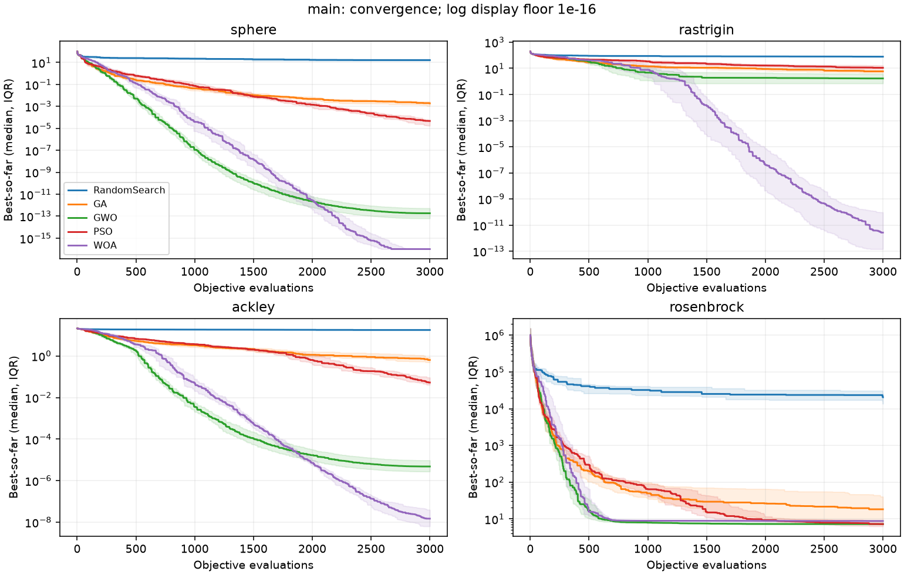

# Metaheuristics Lab

[](https://github.com/Ehsan-Rezaeii/metaheuristics-lab/actions/workflows/ci.yml)

**A reusable optimization library built from scratch with NumPy.** It implements Genetic Algorithm (GA), Grey Wolf Optimizer (GWO), Particle Swarm Optimization (PSO), Whale Optimization Algorithm (WOA), binary GA/GWO variants, and Random Search through a consistent, tested Python API.

**Research question:** How do these optimizers behave under equal objective-evaluation budgets, and can their binary variants serve as reusable building blocks for feature-selection studies?

The focus is **correct implementations, reproducible experiments, transparent baselines, and practical reuse**—not unsupported claims of state-of-the-art performance.

## At a glance

| What is included | Verified evidence |
|---|---|
| **Continuous optimization:** GA, GWO, PSO, WOA, Random Search | 4 benchmark functions × 5 methods × 20 seeds = **400 main runs** |
| **Binary optimization:** Binary GA, Binary GWO (S/V), binary Random Search | **12 feature-selection searches** on a synthetic classification task |
| **Fair evaluation budgets** | **1,200,000** benchmark objective calls; exactly **3,000 per main run** |
| **Software quality** | **114 passing tests**, **99% statement coverage**, CI on Python 3.10/3.12/3.13 |

The benchmark results and raw traces are committed to the repository; the four application projects below consume this library as an **installed, commit-pinned dependency**, not as copied optimizer code.

## A shared foundation for four research applications

The following repositories install this library from the reviewed Git commit [`6b4ef0f`](https://github.com/Ehsan-Rezaeii/metaheuristics-lab/tree/6b4ef0fa3d72f608146f3dd7eabb84bf39fa896e). Each poses a different question; their results are **not directly comparable across datasets or metrics**.

| Application | Reuse of this library | What the study found |
|---|---|---|
| [Breast Cancer Feature Selection](https://github.com/Ehsan-Rezaeii/breast-cancer-feature-selection) | Binary GA/GWO and binary Random Search for feature masks | On one holdout, GWO-S used **15/30 features** and matched the all-features malignant recall (**40/42**); this does not establish clinical equivalence. |
| [Software Defect Prediction](https://github.com/Ehsan-Rezaeii/software-defect-prediction) | Binary GA/GWO and Random Search over software metrics | The simpler **SelectKBest** baseline led on Ant 1.7 MCC, F1 and Average Precision; the search methods selected fewer metrics. |
| [SQL Injection Detection Lab](https://github.com/Ehsan-Rezaeii/sqli-detection-lab) | Binary feature selection over structural HTTP-parameter features | Structural and hybrid classifiers had the same final confusion matrix; strong source/generator confounding limits generalization. |
| [Search-Based Test Generation](https://github.com/Ehsan-Rezaeii/search-based-test-generation) | Continuous GA and Random Search adapted to integer test inputs | On six small white-box fixtures, GA averaged **98.47%** observed branch-outcome coverage versus **95.83%** for Random Search. |

This separation is intentional: **Project 1 owns the optimizers; application repositories own their datasets, objectives, evaluation protocols and claims.**

## Measured benchmark results

The main benchmark uses **10-dimensional** Sphere, Rastrigin, Ackley, and Rosenbrock functions, **20 seeds (0–19)**, population size **30**, and an identical budget of **3,000 objective evaluations per run**.

**Mean final objective (lower is better):**

| Method | Sphere | Rastrigin | Ackley | Rosenbrock |
|---|---:|---:|---:|---:|
| Random Search | 16.86 | 77.91 | 17.72 | 21,430 |
| GA | 0.002076 | 6.138 | 0.7499 | 27.15 |
| GWO | 4.053e-13 | 2.254 | 6.871e-06 | 7.338 |
| PSO | 4.78e-05 | 12.60 | 0.07066 | **6.776** |
| WOA | **1.238e-16** | **0.6029** | **3.387e-08** | 7.479 |

WOA obtained the lowest mean on three functions, while PSO had the lowest Rosenbrock mean **under this specific configuration**. The means do not capture all variability: for example, WOA's Rastrigin results included an unsuccessful seed (maximum final objective **12.0574**). These observations do not establish a general ranking or statistical superiority.



[Full results with standard deviations and limitations](docs/RESULTS.md) · [Individual runs](results/benchmark_main/runs.csv) · [Benchmark summary](results/benchmark_main/summary.csv) · [Final-outcome distribution](results/benchmark_main/final_objectives.png)

### Binary feature-selection demonstration

A separate **synthetic** experiment compares Binary GA, Binary GWO-S, Binary GWO-V and binary Random Search against all-features and SelectKBest baselines. It uses 400 examples, 16 input features, training-only three-fold CV, one fixed 25% held-out split, and **90 evaluations × 3 seeds per search method**.

In these measured runs, Binary GWO-S selected **7.33 features on average** and achieved **0.8167 ± 0.0208** held-out accuracy across three seeds. Binary GA averaged **0.7967 ± 0.0058**; the all-features baseline scored **0.8000** in its single assessment. This is a small demonstration—not an independent generalization study or evidence that a metaheuristic reliably beats simpler feature selection.

[Detailed feature-selection results](docs/RESULTS.md#synthetic-feature-selection-demonstration) · [Feature-selection figure](results/feature_demo/feature_selection.png)

## Use the library

### Install

Python **3.10+** and NumPy are required. Git is needed to install directly from the repository.

```bash
git clone https://github.com/Ehsan-Rezaeii/metaheuristics-lab.git
cd metaheuristics-lab
python -m venv .venv
source .venv/bin/activate   # On Windows: .venv\Scripts\activate
python -m pip install -e '.[dev,experiments]'
python -m experiments.quickstart
```

For a minimal installation, use `python -m pip install -e .` instead. No separately published PyPI package is assumed.

### Continuous optimization

```python
from metaheuristics_lab import GWO, benchmark_problem

problem = benchmark_problem("sphere", dimension=5)
result = GWO(population_size=20).optimize(problem, max_evaluations=1_000, seed=42)

print("Best solution:", result.best_solution)
print("Best objective:", result.best_fitness)
print("Evaluations:", result.n_evaluations)  # Exactly 1,000
```

### Binary optimization

```python
from metaheuristics_lab import BinaryGA, BinaryGWO, Problem


# A toy, explicitly defined mask objective; not a trained ML classifier.
# Prefer fewer selected bits, but require feature 0.
def mask_cost(mask):
    return float(mask.sum() + 10 * (1 - mask[0]))


problem = Problem.binary(mask_cost, dimension=8)
ga_result = BinaryGA(population_size=12).optimize(problem, max_evaluations=90, seed=0)
gwo_result = BinaryGWO(population_size=12, transfer="v").optimize(
    problem, max_evaluations=90, seed=0
)

print(ga_result.best_solution.astype(int))
print(gwo_result.best_solution.astype(int))
```

All optimizers minimize the supplied objective. `Problem.continuous(...)` supports scalar or per-dimension box bounds; `Problem.binary(...)` supports bit vectors. **Application code defines its own objective and the meaning of each selected bit.**

### Shared API and reproducibility guarantees

```python
result = optimizer.optimize(problem, max_evaluations=budget, seed=seed)
```

- `OptimizationResult` contains `best_solution`, `best_fitness`, `n_evaluations`, `history`, `evaluations`, and `runtime_seconds`.
- Every objective call counts—including initialization and duplicate candidates. A run uses **exactly** the requested budget, even when the final generation is partial.
- `history[i]` is the best-so-far objective after evaluation `i + 1`; optimizers never reevaluate the returned best point merely to report it.
- Local random generators and recorded seeds support deterministic optimizer behavior for a deterministic objective. Timings, and randomness inside user-provided objectives, are not guaranteed to reproduce bit for bit.
- Binary GA uses crossover and bit-flip mutation. Binary GWO has explicitly defined **S-shaped** (`transfer="s"`) and **V-shaped** (`transfer="v"`) bit-update semantics; it is a documented reference variant, not a claim of exact equivalence to every published binary GWO algorithm.

For defaults, constraints, implementation decisions, and equations, see the [implementation walkthrough](docs/IMPLEMENTATION_WALKTHROUGH.md) and [experimental protocol](docs/EXPERIMENT_PROTOCOL.md).

## Reproduce and verify

The repository contains recorded settings, full experimental results, convergence histories, tests, and CI workflows. Main experiments are **not rerun automatically in CI**.

```bash
# Lint, tests, smoke checks, and packaging
ruff check .
ruff format --check .
python -m pytest --cov=metaheuristics_lab --cov-report=term-missing
python -m experiments.quickstart
python -m build

# Reproduce the main experiments into new directories
python -m experiments.benchmark --output results/my_benchmark_main
python -m experiments.feature_selection --output results/my_feature_demo
```

The main continuous experiment performs **1,200,000 objective evaluations**; the feature-selection demonstration runs **12 searches** (1,080 objective calls, plus model fits). Experiment outputs should go to **fresh directories**, since checked-in results are protected from accidental overwriting.

For the recorded Python 3.12 experiment environment, use `requirements-lock.txt` as an environment snapshot; it is not a universal cross-platform lockfile. Source distribution and wheel builds, clean external wheel imports, and tests are verified by [GitHub Actions](https://github.com/Ehsan-Rezaeii/metaheuristics-lab/actions). See the [results and verification notes](docs/RESULTS.md) for exact configurations, timing methodology and evidence.

## Scope and limitations

- **Educational and research-oriented reference implementations:** no state-of-the-art, production optimization or universal algorithm ranking is claimed.
- **Benchmarks:** four unshifted functions can favor origin-seeking behavior; fixed parameters, 20 seeds and bounded problems do not support general conclusions across tasks.
- **Constraints and optimization:** the implementations handle continuous box bounds or binary domains, but not general constraints, noise-aware optimization, parallel execution or automatic hyperparameter tuning.
- **Binary evaluation:** the synthetic feature-selection demonstration uses one split and three search seeds; it is not a clinical or real-world generalization claim. Adaptive search can overfit the training CV objective.
- **Implementation choices:** clipping, update schedules and Binary GWO transfer rules are specified and tested, but are not asserted to reproduce all published variants exactly.

## References and attribution

The optimization algorithms are implemented in this repository rather than imported from external optimization libraries. Relevant original work and methodological context:

- Holland (1975), *Adaptation in Natural and Artificial Systems* — genetic algorithms.
- Mirjalili, Mirjalili & Lewis (2014), [*Grey Wolf Optimizer*](https://doi.org/10.1016/j.advengsoft.2013.12.007).
- Kennedy & Eberhart (1995), [*Particle Swarm Optimization*](https://doi.org/10.1109/ICNN.1995.488968).
- Mirjalili & Lewis (2016), [*The Whale Optimization Algorithm*](https://doi.org/10.1016/j.advengsoft.2016.01.008).
- Mirjalili & Lewis (2013), [*S-shaped versus V-shaped transfer functions for binary Particle Swarm Optimization*](https://doi.org/10.1016/j.swevo.2012.09.002) — motivation for transfer families, **not** an implementation reference for this binary GWO variant.
- [scikit-learn synthetic classification generator](https://scikit-learn.org/stable/modules/generated/sklearn.datasets.make_classification.html) — source of the feature-selection demo data.

**License:** [MIT](LICENSE). Dataset sources, experimental results and associated papers retain their own provenance and attribution.
